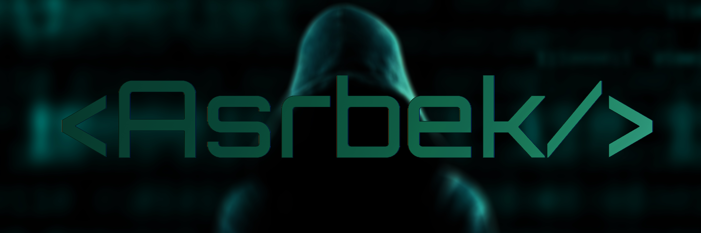

<!-- ═══════════════ HEADER ═══════════════ -->
<p align="center">
  
</p>

<p align="center">
  <a href="https://git.io/typing-svg">
    
  </a>
</p>

<p align="center">
  <a href="https://t.me/coder_FS"></a>
  <a href="https://github.com/AsrbekCoder"></a>
  
</p>

<p align="center">
  
</p>

<!-- ═══════════════ ABOUT ═══════════════ -->
##  About me

I'm a **Full Stack wizard** with **5+ years** of experience, conjuring code to make open-source contributions as easy as a flick of the wand. 🪄
My passion? Building tech that doesn't just elevate people — it makes them want to **dance**! 💃🕺

Whether I'm taming **ReactJS** dragons 🐉, herding **NodeJS** gnomes 🧌, or spinning webs with **WebSocket** 🕸️ — I'm all about bringing magic to the digital world. I also dabble in the dark arts of **Computer Vision**, **TensorFlow** and **AI engineering**. 🔮

```js
const asrbek = {
  role:        ["Full Stack Developer", "AI Engineer"],
  work:        "AI unit @ O'zbekiston temir yo'llari 🚆",
  location:    "Uzbekistan 🇺🇿",
  code:        ["JavaScript", "TypeScript", "Python"],
  frontend:    ["React", "SASS", "Bootstrap"],
  backend:     ["Node.js", "WebSocket"],
  ai:          ["TensorFlow", "Computer Vision", "AI Agents"],
  achievements:["🥈 2nd place — National AI Hackathon (team captain, «Uzprogers»)"],
  motto:       "Let's build, laugh, and code like there's no bug in sight! 🚀",
};
```

<!-- ═══════════════ STACK ═══════════════ -->
## 🤹 Tech stack

<p align="center">
  
  <br/><br/>
  
</p>

<!-- ═══════════════ STATS ═══════════════ -->
## 📊 GitHub stats

<p align="center">
  
  
</p>

<p align="center">
  
</p>

<p align="center">
  <a href="https://github.com/AsrbekCoder">
    
  </a>
</p>

<!-- ═══════════════ SNAKE ═══════════════ -->
## 🐍 Contribution snake

<p align="center">
  <picture>
    <source media="(prefers-color-scheme: dark)" srcset="https://raw.githubusercontent.com/AsrbekCoder/AsrbekCoder/output/github-snake-dark.svg" />
    
  </picture>
</p>

<!-- ═══════════════ FOOTER ═══════════════ -->
<p align="center">
  <i>Let's build, laugh, and code like there's no bug in sight!</i> 🚀✨
</p>

<p align="center">
  
</p>
